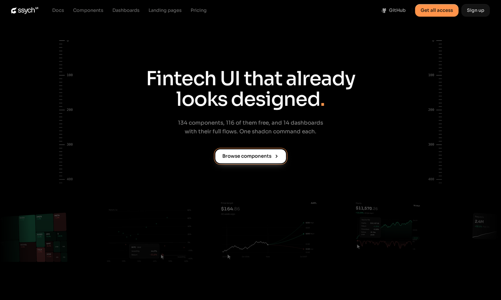
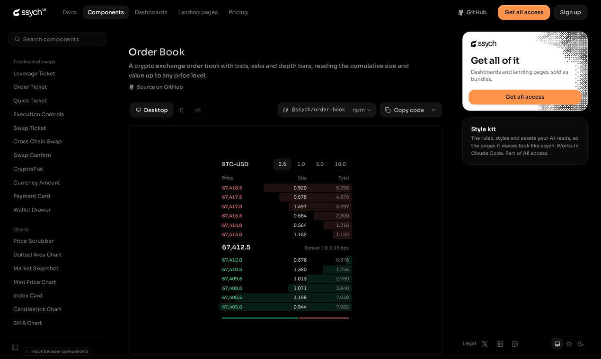
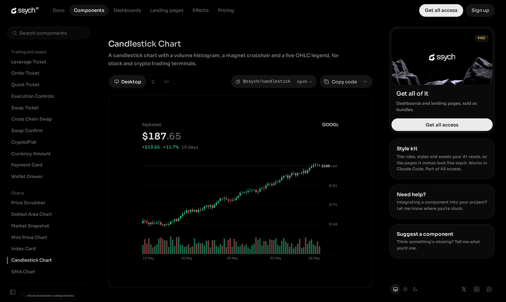
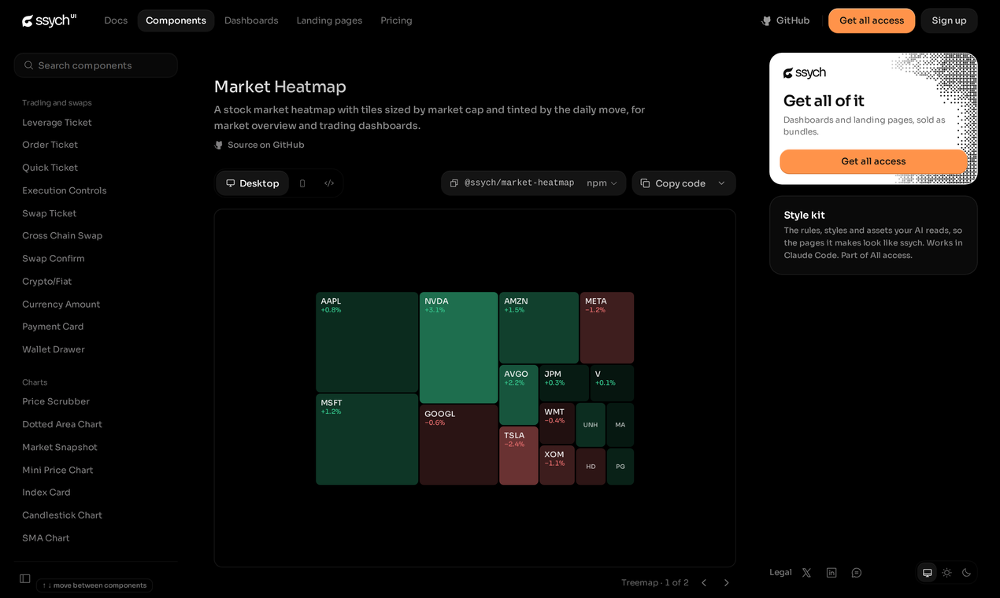
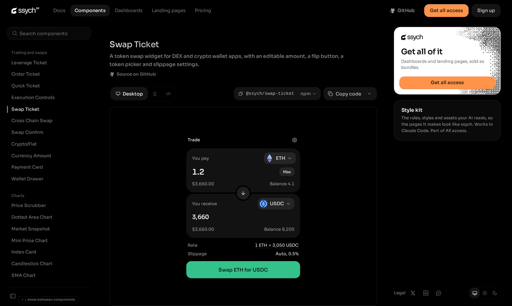
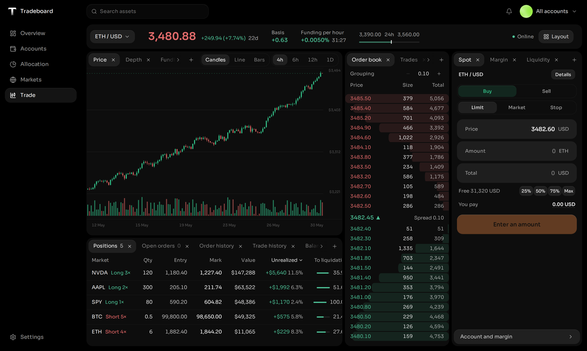

# ssych ui

**Components for dense trading and agent screens.** Order books, candlesticks,
heatmaps, swap tickets, screeners and agent consoles, built for screens people
have to read fast and trust. Every chart is hand drawn SVG, no chart runtime.
Copy the code, or install any component with the shadcn CLI.

**Live previews:** https://ssych.com/library



<table>
<tr>
<td><br><code>order-book</code></td>
<td><br><code>candlestick</code></td>
</tr>
<tr>
<td><br><code>market-heatmap</code></td>
<td><br><code>swap-ticket</code></td>
</tr>
</table>

## What you get

- **116 free components, MIT.** Use them in anything, commercial included.
- **No chart library.** Charts are plain SVG you can read and change, nothing extra in your bundle.
- **Made for dense data.** Tables, tickets, tapes and charts that stay readable when the screen is full.
- **Your code.** shadcn CLI drops the file into your project, no package to keep updated.

If one of these saves you an afternoon, a star helps other people find the repo.

## Install

Every component is a shadcn registry item:

```bash
npx shadcn@latest add https://ssych.com/r/order-book.json
```

Swap `order-book` for any free slug below.

## Free family — MIT (116 components)

`accordion` · `account-dropdown` · `agent-run-timeline` · `alert-stack` · `allocation-treemap` · `amount-slider` · `amount` · `analyst-radar` · `approval-quorum` · `ascii-badge` · `ascii-turntable` · `assets-balance-card` · `automation-builder` · `avatar-stack` · `balance-chart` · `balance-header` · `bento-gallery` · `browser-window` · `candlestick` · `card-grid` · `card-list` · `card-stack` · `comb-rows` · `cross-chain-swap` · `crypto-fiat` · `cutout-card` · `date-range-picker` · `depth-chart` · `dialog-stack` · `donut-chart` · `dotted-area-chart` · `empty-state` · `equity-drawdown` · `event-feed` · `execution-controls` · `file-tree` · `fills-blotter` · `flow-bars` · `gantt-mini` · `glass-badge` · `gold-badge` · `graph-comparison` · `health-gauge` · `heat-calendar` · `historical-eps` · `holdings-table` · `holo-badge` · `inbox` · `index-card` · `info-card` · `inline-slider` · `kanban-board` · `kpi-card-row` · `leverage-ticket` · `lightning-badge` · `macbook-frame` · `macos-dock` · `market-heatmap` · `market-shelf` · `market-snapshot` · `market-watchlist` · `matrix-ticker-board` · `metal-badge` · `modal` · `model-comparison` · `morph-disclosure` · `mouse-trail-cta` · `neon-badge` · `new-items-pill` · `news-card` · `onboarding-checklist` · `order-book` · `order-ticket` · `payment-card` · `performance-chart` · `positions-table` · `preferences-card` · `price-scrubber` · `price-target-fan` · `project-card` · `project-index` · `quick-ticket` · `radial-gauge` · `range-navigator` · `ratings-radar` · `release-feed` · `request-log` · `returns-calendar` · `sankey-flow` · `scatter-plot` · `screen-shuffle` · `sectors-donut` · `segmented-control` · `series-spotlight` · `setup-stepper` · `sidebar` · `simple-chart` · `sma-chart` · `stacked-bars` · `stat-tile` · `stone-badge` · `swap-confirm` · `swap-ticket` · `tape-flow` · `ticker-tape` · `tool-call-card` · `top-coins` · `total-balance` · `trade-journal-table` · `trade-tape` · `uptime-bars` · `view-switch` · `vitals-strip` · `volume-profile` · `wallet-drawer` · `watchlist-stack`

## Paid screens and landing pages



Composed dashboards and landing pages (24 of them) are sold separately at https://ssych.com/library.
None of their code is in this repo, and nothing in this repo is paid: every
component listed above is MIT. One name is used twice: the free `market-watchlist` component here is MIT, and a paid screen of the same name is sold on the site; install the free one from this repo's `components/ui`.

## License

Everything in this repo: [MIT](./LICENSE). Paid screens and landing pages are not in
this repo and are sold under their own licence at https://ssych.com/library.

Every component here is original work. Icons, the font and npm dependencies keep their
own licences: see [THIRD_PARTY_NOTICES.md](./THIRD_PARTY_NOTICES.md).
